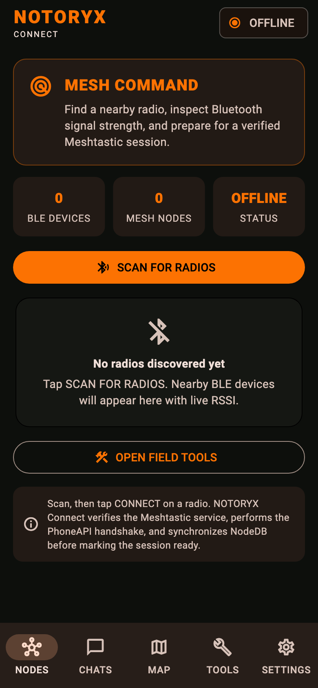
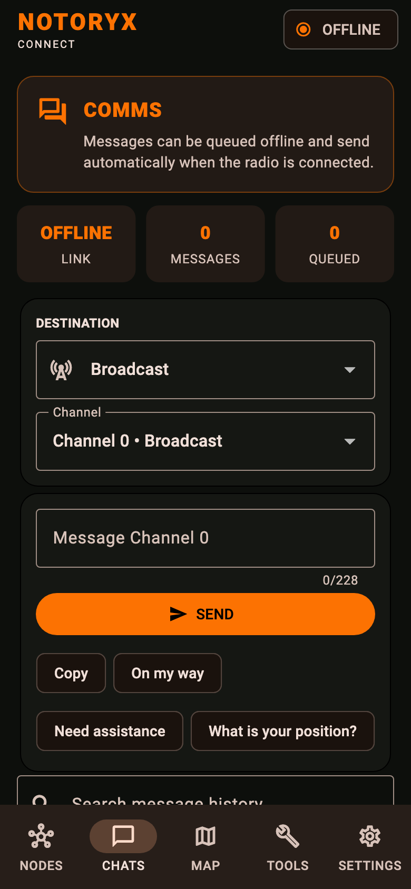
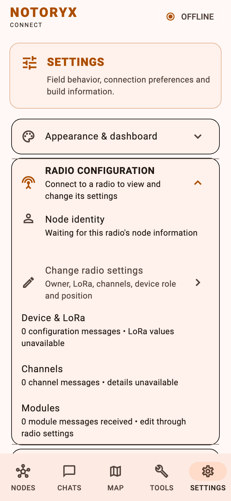

<p align="center">
  
</p>

# NOTORYX Connect

Part of the **NOTORYX** off-grid communications family. **No Towers. No Limits.**

**An independent Android field app for LoRa mesh radios running Meshtastic® firmware.**

NOTORYX Connect pairs your phone with a radio over Bluetooth so you can message, map and manage the mesh without cell service. It interoperates with Meshtastic® firmware while keeping its own name, icon, interface and project identity.

> **Independent project:** NOTORYX Connect (formerly Bastion) is not affiliated with, sponsored by, endorsed by, or an official application of Meshtastic LLC.

<p align="center">
  
  
  
  
</p>

> NOTORYX Connect is a beta. It has been checked on one radio (a Seeed T1000-E) and in automated tests, not yet on a wide range of phones, radios and firmware versions. Don't rely on it as your only way to call for help. Please [report issues](../../issues).

## Download

Get the latest beta from **[NOTORYX Connect releases](https://github.com/TheLogsAreScreaming/notoryx-connect-releases/releases)**. Each release lists what changed and includes a `SHA256SUMS.txt` file for checking your download.

| Platform | File | Notes |
|---|---|---|
| Android (ARM64 phones) | `…-arm64.apk` | Signed with the release key |

A universal macOS build (Intel and Apple silicon) can be built with the **NOTORYX macOS Build** workflow but isn't released yet.

### Install on Android

1. On your phone, open the release and download the `.apk`.
2. Open the file. If Android asks, allow installs from your browser or file manager.
3. Open NOTORYX Connect and allow **Bluetooth**, **location** and **notifications** when asked.

**Upgrading from v0.1.3-beta.1 or earlier:** the app ID changed from `org.backcountrysignal.bastion` to `com.bastionmesh.connect`, so the next release installs as a separate app instead of updating the old one. Before switching, make a backup in the old app (**Settings → Phone data backup / restore**, and **Encrypted radio backup / restore** if you want one), install the new app, restore the backup there, then uninstall the old app. You only do this once.

## Getting started

1. **Connect your radio.** On **NODES**, tap **Scan for radios**, then **Connect** next to your radio. NOTORYX Connect checks the Meshtastic service, runs the PhoneAPI handshake and syncs the node list before it marks the session ready. It reconnects on its own if the link drops.
2. **Send a message.** On **CHATS**, pick **Broadcast** or a node, choose a channel and send. Messages typed while you're offline are queued and sent when the radio is back.
3. **Check your radio's settings.** **SETTINGS → Radio configuration** shows the node's identity, LoRa settings, channels and modules, and every change is read back from the radio to confirm it saved.
4. **Prepare for the field.** **TOOLS** has the deployment checklist, battery runtime estimate, incident log and message templates.

## Features

### Messaging
- Channel and direct messages with delivery states from routing acknowledgments, and a thread for each node.
- Offline queue: messages wait on the phone and send when the radio reconnects.
- Search across all saved messages, including queued ones.
- Quick replies (On my way, Need assistance, What is your position?) and check-in, assistance and all-clear templates that you review before sending.
- Chat history, queue and node list are kept separately for each radio you use.
- Optional **Bot Mode** with an away reply, quiet hours, reply limits and loop protection.

### Nodes and maps
- Node list with favorites, notes, telemetry, signal history, traceroute (with SNR for each hop) and neighbors.
- Map of node positions and waypoints. OpenStreetMap areas you've viewed stay cached offline for a year.
- Opt-in phone GPS sharing, with optional rounding of your shared position (about 360 m, 1.5 km or 6 km).

### Radio management
- Every config section and module can be edited through a generated settings form. Saves are allowed only on an authenticated, connected session, and each one is verified with a fresh read from the same radio.
- Share and import channels as `meshtastic.org/e/#` links or QR codes, including camera scanning.
- **Encrypted radio settings backup and restore** (AES-256-GCM, PBKDF2 with 600,000 iterations), with a preview and confirmation. It doesn't include device identity keys or session credentials.

### Field tools
- Incident log, coverage observations (receiver location, SNR and RSSI) and CSV export.
- Deployment checklist, battery runtime estimate and an RSSI field reference.
- Local alerts on the phone: low battery on your radio or favorites, new nodes heard, and favorites going quiet.
- Low-power field mode, which lowers GPS accuracy and update rate to save battery.
- Background connection service on Android so the link stays up with the screen off.

### Privacy and backups
- **Settings → Privacy & data** explains what's stored and sent, and can delete chat history or all phone data.
- **Encrypted phone data backup** to a file: chats and queues for every radio, NodeDex, waypoints, field records and settings. Restoring replaces everything and rolls back if it fails.
- Light, dark and system themes, and layouts that hold up with large text.

## Safety

NOTORYX Connect may support field and emergency-communications workflows, but software and mesh radio links are not guaranteed emergency lifelines. Keep backup communications and a safety plan suited to where you're going.

## Building from source

Requirements: Flutter 3.47.7, Java 17 and the Android SDK.

```sh
flutter create --no-pub --platforms=android --org com.bastionmesh --project-name bastion .
git checkout -- pubspec.lock   # flutter create replaces it with a template
python3 scripts/prepare_android.py
flutter pub get --enforce-lockfile
dart run flutter_launcher_icons
flutter analyze
flutter test
flutter run
```

CI generates the Android project with the Dart project name `bastion` and organization `com.bastionmesh`. `scripts/prepare_android.py` then sets the application ID to `com.bastionmesh.connect` and adds the Bluetooth, location and notification permissions.

Dependency versions are locked in the committed `pubspec.lock`, and CI runs `flutter pub get --enforce-lockfile`, so every build uses the same packages. To change a dependency, edit `pubspec.yaml`, run plain `flutter pub get`, and commit the updated `pubspec.lock`.

The README screenshots are rendered by `test/preview/screens_preview_test.dart`:

```sh
PREVIEW_OUT=docs/screenshots flutter test test/preview
```

### macOS

The **NOTORYX macOS Build** workflow (manual, also run on PRs that change the macOS build) generates the macOS project, applies `scripts/prepare_macos.py` (app name, Bluetooth/camera/location prompts, sandbox entitlements, Impeller off for Intel Macs) and builds a universal Intel + Apple silicon `NOTORYX Connect.app`, zipped as `NOTORYX-Connect-<version>-macOS-universal.zip`. It is ad-hoc signed, not notarized: on first launch, right-click the app and choose **Open**. Android-only features (background connection service, notifications) are inactive on macOS. Bundle ID `com.bastionmesh.connect` is separate from NOTORYX Core (`com.bastionmesh.bastion`), so both apps can be installed side by side.

### Build validation and releases

Pull requests and pushes run the Android CI workflow: Flutter analysis, tests, an ARM64 release APK build and a retained APK artifact. Signed candidates are built by the manual main-branch workflow and are not published automatically. A build isn't production-ready until hardware testing, release signing, dependency and license review, privacy review and release QA are done. See [release readiness](docs/RELEASE-READINESS.md), the [device test checklist](docs/DEVICE-TEST-CHECKLIST.md) and [branch/PR triage](docs/BRANCH-AND-PR-TRIAGE.md).

## App icon and artwork

The NOTORYX Connect icon artwork is in `branding/`:

| File | Use |
|---|---|
| `notoryx-icon-source.png` | Original artwork (1254 px) |
| `notoryx-icon.png` | Launcher icon for older Android versions (1024 px) |
| `notoryx-icon-foreground.png` | Adaptive icon foreground: the N mark on transparency, inside the safe zone, over `#101011` |

Play Store graphics (512 px icon, 1024 × 500 feature graphic) are in `fastlane/metadata/android/en-US/images/`. `python3 tool/make_store_graphics.py` regenerates all of these from the source artwork (needs Pillow).

The icon and NOTORYX Connect visual identity are independent artwork and must not incorporate the official Meshtastic logo unless a future use is separately authorized and complies with the then-current trademark rules.

## Compatibility

NOTORYX Connect implements interoperability with the public protocol used by Meshtastic® firmware. Technical references to Meshtastic® in source code and documentation describe compatibility or protocol behavior; they are not NOTORYX Connect product branding.

NOTORYX Connect does not use “Meshtastic” in its primary or secondary software product name. The official Meshtastic logo is not used as the NOTORYX Connect application icon or primary branding.

## Trademark and licensing notice

Meshtastic® is a registered trademark of Meshtastic LLC. Meshtastic software components are released under various licenses, see GitHub for details. No warranty is provided - use at your own risk.

NOTORYX Connect is independently developed and is not affiliated with, sponsored by, or endorsed by Meshtastic LLC. All Meshtastic® trademarks remain the property of Meshtastic LLC.

Official policy and project information:

- Licensing and trademark rules: https://meshtastic.org/docs/legal/licensing-and-trademark/
- Official website: https://meshtastic.org/
- Official GitHub organization: https://github.com/meshtastic

See [TRADEMARKS.md](TRADEMARKS.md) for NOTORYX Connect's trademark-use rules.

## Upstream software and third-party licenses

Meshtastic software components are released under various licenses. NOTORYX Connect must preserve all applicable license notices, attribution, source-distribution obligations, and other requirements for any upstream component that is actually incorporated into the project.

NOTORYX Connect includes generated protocol bindings from `meshtastic/protobufs` v2.8.1. Its GPL-3.0 license text is preserved in `licenses/meshtastic-protobufs-GPL-3.0.txt`. NOTORYX Connect is licensed under GPL-3.0; see [LICENSE](LICENSE). Keep the generated-code and third-party notices with distributed builds.

Third-party Flutter/Dart dependencies remain subject to their respective licenses.

## Contributing

Testing, bug reports, hardware compatibility reports and feature ideas are welcome. Contributions must preserve NOTORYX Connect's independent branding and comply with [TRADEMARKS.md](TRADEMARKS.md) and all applicable third-party licenses.
